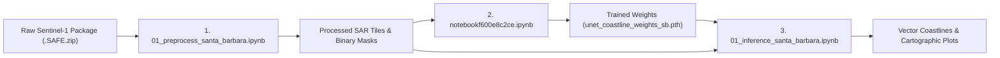

# Automated Coastline Extraction using Sentinel-1 SAR & U-Net (Prototype 1)

An end-to-end deep learning pipeline for automated coastal boundary detection from satellite radar imagery. This prototype focuses on the Santa Barbara coastal region, converting raw Sentinel-1 Synthetic Aperture Radar (SAR) imagery into high-precision, vectorized coastline contours using a custom PyTorch U-Net architecture.

---

## 🌊 Project Motivation

### Why Coastlines Matter
Coastlines are dynamic boundaries constantly reshaped by tidal shifts, severe storms, climate change, and sea-level rise. Accurate and timely coastline mapping is essential for:
- Coastal erosion monitoring and disaster response (e.g., storm surges, tsunamis).
- Environmental and marine habitat conservation.
- Maritime navigation and civil infrastructure planning.

### Why SAR (Synthetic Aperture Radar)?
Traditional optical satellite imagery (like Landsat or Sentinel-2) fails when clouds, fog, smoke, or night cover the area. In contrast:
- **All-Weather, Day-and-Night Capability**: SAR is an active sensor that emits microwave radar pulses down to Earth and records the backscattered energy, effortlessly penetrating clouds and weather.
- **Physical Scattering Difference**: Water surfaces act like flat mirrors (specular reflection), bouncing radar pulses away from the satellite, which makes water appear **dark (low backscatter)**. Land features (vegetation, cliffs, urban structures) cause rough scattering (diffuse backscatter), returning significant energy and appearing **bright (high backscatter)**.

### The Objective of This Project
To replace labor-intensive manual coastline digitizing with an automated, AI-driven workflow that ingests raw satellite packages, prepares calibrated training tiles, trains a semantic segmentation neural network, and vectorizes crisp coastline boundaries.

---

## 📁 Repository Overview

```text
proto1_CoastlineExtraction_/
│
├── 01_preprocess_santa_barbara.ipynb    # Step 1: Raw radar data extraction, physics calibration, tiling & mask generation
├── notebookf600e8c2ce.ipynb             # Step 2: Custom PyTorch dataset, U-Net training loop & model export
├── 01_inference_santa_barbara.ipynb     # Step 3: Model inference, probability heatmaps & coastline vector tracing
│
├── unet_coastline_weights_sb.pth        # Pre-trained U-Net model weights (state_dict)
├── S1A_IW_GRDH_...SAFE.zip              # Raw Copernicus Sentinel-1 Ground Range Detected data package
└── README.md                            # Project documentation
```

---

## 🚀 Execution Sequence (Step-by-Step Order)

To replicate or run this project from start to finish, execute the notebooks in the following sequential order:



### Step 1: Preprocessing & Ground Truth Generation
**Notebook:** `01_preprocess_santa_barbara.ipynb`
- **Input**: Raw Sentinel-1 Level-1 GRD `.SAFE.zip` file.
- **Workflow**:
  1. **TIFF Extraction**: Unzips the measurement folder and extracts the VV (Vertical-Vertical) polarization band.
  2. **Radiometric Calibration**: Converts raw Digital Numbers (integers) to scientific radar backscatter intensity in Decibels (dB) using logarithmic compression ($10 \cdot \log_{10}(\text{DN}^2)$).
  3. **Speckle Noise Filtering**: Applies a 2D Median Filter ($7 \times 7$) to suppress granular radar noise (speckle).
  4. **Dynamic Normalization & Tiling**: Normalizes radar intensities using percentile clipping (2nd to 98th percentile) to 8-bit image scale (0–255) and slices the Region of Interest (ROI) into uniform $256 \times 256$ PNG tiles (`data_processed/sar_tiles`).
  5. **Automated Ground Truth Masking**: Applies Otsu’s automatic thresholding to generate paired binary land/water masks (`data_processed/masks`).
- **Output**: Paired dataset of SAR image tiles and binary ground-truth masks.

---

### Step 2: Neural Network Model Training
**Notebook:** `notebookf600e8c2ce.ipynb` *(Designed for GPU training on Kaggle or local CUDA machines)*
- **Input**: Paired image tiles and masks from Step 1 (`data_processed/`).
- **Workflow**:
  1. **Custom PyTorch Dataset & DataLoader**: Loads paired images and masks, applying normalization and batch generation.
  2. **U-Net Architecture**: Builds an encoder-decoder convolutional network with skip connections:
     - **Encoder (Downsampling)**: Extracts multi-scale visual features through consecutive convolutions, batch normalization, ReLU activations, and max-pooling.
     - **Bottleneck**: Deepest layer representing latent image features.
     - **Decoder (Upsampling)**: Uses transposed convolutions to restore spatial resolution, concatenating skip connections from encoder layers to preserve fine edge details.
     - **Head**: $1 \times 1$ convolution with Sigmoid activation outputting land/water probabilities ($0.0$ to $1.0$).
  3. **Optimization Loop**: Trains using Binary Cross Entropy Loss (`nn.BCELoss`) and the Adam optimizer (`lr=0.0001`).
- **Output**: Saved model weights file: `unet_coastline_weights_sb.pth`.

---

### Step 3: AI Inference & Coastline Vectorization
**Notebook:** `01_inference_santa_barbara.ipynb`
- **Input**: `unet_coastline_weights_sb.pth` and target SAR tiles.
- **Workflow**:
  1. **Model Instantiation**: Loads the U-Net architecture and injects the learned weights.
  2. **Forward Inference**: Passes test SAR tiles through the network to generate continuous probability heatmaps.
  3. **Marching Squares Vectorization**: Applies the Marching Squares contour extraction algorithm (`skimage.measure.find_contours`) at a 50% decision threshold ($0.5$).
  4. **Visualization & Validation**: Overlays the extracted vector lines on raw radar tiles and compares them against Otsu ground-truth masks.
- **Output**: Clean vector coastline coordinates and diagnostic evaluation plots.

---

## 🛠️ Installation & Environment Setup

### 1. Requirements
Ensure you have **Python 3.9+** (tested up to Python 3.14) and install the required dependencies:

```bash
pip install torch torchvision numpy scipy matplotlib pillow rasterio scikit-image
```

### 2. Hardware Recommendation
- **Inference & Preprocessing**: Runs smoothly on standard CPU.
- **Training**: CUDA-enabled NVIDIA GPU recommended (can be trained locally or on Kaggle/Google Colab).

---

## ⚙️ Path Configuration Guide

All notebooks feature placeholder variables so you can point them to your local directory structure:

| Notebook | Placeholder Variable | Description | Typical Value |
| :--- | :--- | :--- | :--- |
| `01_preprocess_santa_barbara.ipynb` | `zip_path` | Path to downloaded Sentinel-1 `.SAFE.zip` file | `r"./S1A_IW_GRDH_...SAFE.zip"` |
| `01_preprocess_santa_barbara.ipynb` | `extracted_path` (`path=...`) | Directory to extract raw `.tiff` data | `r"./data_raw"` |
| `01_preprocess_santa_barbara.ipynb` | `sar_tiles_output_dir` | Directory where generated SAR tiles are saved | `r"./data_processed/sar_tiles"` |
| `01_preprocess_santa_barbara.ipynb` | `masks_output_dir` | Directory where generated binary masks are saved | `r"./data_processed/masks"` |
| `notebookf600e8c2ce.ipynb` | `DATA_ROOT` | Root directory containing `sar_tiles/` and `masks/` | `r"./data_processed"` |
| `notebookf600e8c2ce.ipynb` | `save_path` | Path where trained weights are saved | `r"./unet_coastline_weights_sb.pth"` |
| `01_inference_santa_barbara.ipynb` | `weights_path` | Path to load trained model weights | `r"./unet_coastline_weights_sb.pth"` |
| `01_inference_santa_barbara.ipynb` | `tile_dir` / `test_image_path` | Directory or file path of SAR tiles to test | `r"./data_processed/sar_tiles"` |

---

## 📖 Key Technical Concepts Explained

> [!NOTE]
> ### 1. Sentinel-1 GRD & VV Polarization
> - **Sentinel-1** is a European Space Agency (ESA) constellation carrying a C-band radar.
> - **GRD (Ground Range Detected)**: Raw satellite data projected onto the Earth's surface ellipsoid with square pixels and reduced speckle.
> - **VV Polarization**: Radar waves transmitted vertically and received vertically. VV is especially sensitive to surface roughness, creating contrast between smooth ocean water and textured land.

> [!NOTE]
> ### 2. Decibel (dB) Radiometric Calibration
> Raw satellite pixels represent raw Digital Numbers (DN). Because radar returns span huge orders of magnitude, we convert them into Decibels:
> $$\sigma^0 (\text{dB}) = 10 \cdot \log_{10}(\text{DN}^2 + 10^{-10})$$
> This compresses the dynamic range so both subtle water waves and bright urban reflections can be processed effectively.

> [!NOTE]
> ### 3. Speckle Noise & Median Filtering
> Radar images feature an inherent "salt-and-pepper" noise called **speckle**, caused by constructive and destructive interference of the coherent radar waves bouncing off micro-surfaces. A $7 \times 7$ median filter smooths speckle while preserving true physical edges like cliffs and coastlines.

> [!NOTE]
> ### 4. Otsu's Thresholding
> An automated clustering threshold algorithm that calculates the optimal pixel intensity cut-off minimizing intra-class variance between the two peaks of a bimodal histogram (dark water vs. bright land).

> [!NOTE]
> ### 5. U-Net & Skip Connections
> Standard CNNs lose fine spatial details through repeated pooling layers. U-Net solves this by using **skip connections**, which directly copy high-resolution spatial feature maps from the encoder to the decoder. This allows the network to know both **what** an object is (deep semantic context) and **where** its boundary lies (pixel-level localization).

> [!NOTE]
> ### 6. Marching Squares Algorithm
> A computer graphics algorithm that converts continuous 2D probability matrices into precise vector contours $(x, y)$. By placing a contour at the 50% probability threshold, it traces continuous vector coastlines suitable for GIS and mapping.

---

## 🔮 Future Roadmap (Beyond Prototype 1)

- [ ] **Georeferencing Integration**: Converting pixel contour coordinates directly to GeoJSON / ESRI Shapefile formats with WGS84 (EPSG:4326) or UTM projections.
- [ ] **Multi-Region Expansion**: Expanding training beyond Santa Barbara to diverse coastal geologies (e.g., sandy beaches, rocky cliffs, mangrove estuaries, mudflats).
- [ ] **Temporal Analysis**: Comparing coastlines across different seasons to measure long-term shoreline retreat or accretion rates.

